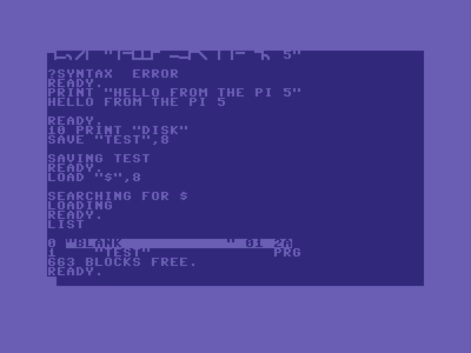
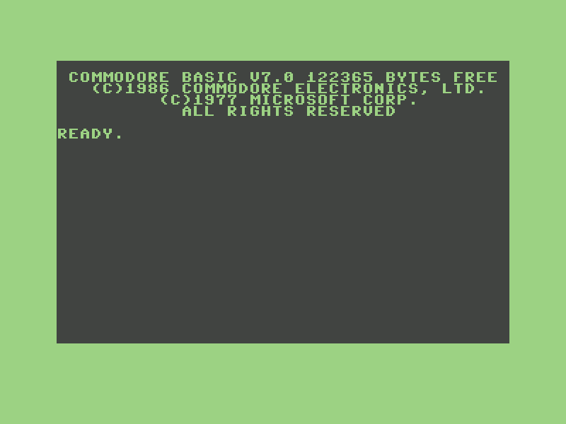
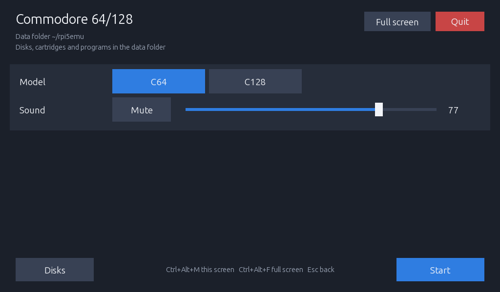
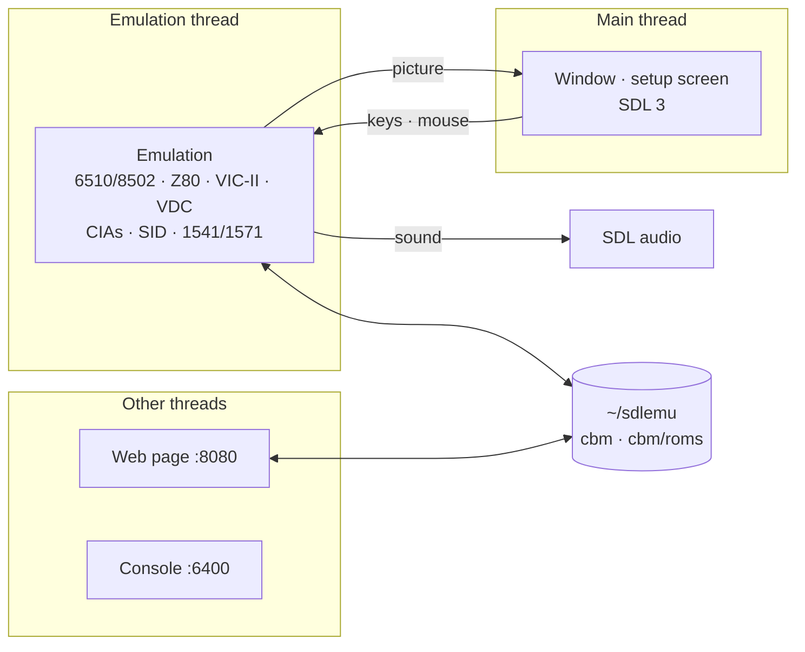

<h1 align="center">sdlcbm</h1>

<p align="center">
  <b>A Commodore 64 or 128 in an SDL 3 window on Linux or macOS.</b><br>
  Cycle-exact 6510 and CIAs, VIC-II, SID, real 1541 and 1571 drives, the C128's 80 columns, FAST mode and CP/M.
</p>

<p align="center">
  
  
  
  
  
  
</p>

<p align="center">
  <b>Work in progress:</b> not everything has been tested, and games and demos may or may not
  work satisfactorily.
</p>

<p align="center">
  
  
  <br>
  <sub>The C64 saving a program through its 1541 and listing the directory, and the C128's BASIC 7.0, on the Pi.</sub>
</p>

sdlcbm runs [esp32cbm](https://github.com/rlucencic/esp32cbm)'s Commodore on 64-bit Linux (arm64 and amd64) and Apple Silicon macOS. SDL 3 provides the window, sound and input. The machine is the
same code as on the ESP32 boards: esp32cbm's platform-independent core and
[esp32emu](https://github.com/rlucencic/esp32emu)'s CPU core, on
[sdlemu](https://github.com/rlucencic/sdlemu), the family's desktop runtime: a setup
screen in the window, sound, the host's keyboard and mouse, a web page on your network and a
console.

It belongs to the SDL desktop family of the ESP32 emulators:
[sdlzx](https://github.com/rlucencic/sdlzx) (ZX Spectrum),
[sdlcpc](https://github.com/rlucencic/sdlcpc) (Amstrad CPC),
[sdlcoco](https://github.com/rlucencic/sdlcoco) (Tandy Color Computer 2 and 3),
[sdlgs](https://github.com/rlucencic/sdlgs) (Apple IIGS),
[sdlmsx](https://github.com/rlucencic/sdlmsx) (MSX1 and MSX2),
[sdlxl](https://github.com/rlucencic/sdlxl) (Atari 800XL and 130XE),
[sdlste](https://github.com/rlucencic/sdlste) (Atari STE),
[sdlpc](https://github.com/rlucencic/sdlpc) (IBM PC/XT and PC/AT),
[sdlmac](https://github.com/rlucencic/sdlmac) (Macintosh Plus, SE, Classic),
[sdlmac2](https://github.com/rlucencic/sdlmac2) (Macintosh LC and II),
[sdlmac3](https://github.com/rlucencic/sdlmac3) (Macintosh LC II and LC III),
[sdlarc](https://github.com/rlucencic/sdlarc) (Acorn Archimedes),
[sdlami](https://github.com/rlucencic/sdlami) (Amiga 500, 2000, 600, 1200).

## Features

**The machines**
- **Commodore 64** and **Commodore 128** (PAL), chosen on the setup screen;
  the C128 with 128 KB, BASIC 7.0, and its C64 mode (`GO64`)
- **6510 and 8502**: every bus cycle as the real CPU does it (dummy reads,
  read-modify-write's double write), all undocumented opcodes; passes Klaus
  Dormann's functional test and the whole Lorenz test suite 2.15 (CPU, CIAs,
  interrupts and NMIs to the cycle)
- **VIC-II** (6569): bad lines and sprite DMA take the CPU's cycles, raster
  interrupts, all text and bitmap modes, sprites with collisions, the
  border; lines are drawn as the beam passes them
- **Two 6526 CIAs**: timers to the cycle (start and stop delays, force
  loads, one-shot, timer B counting A, PB6/PB7 outputs), time of day,
  shift register, keyboard, joysticks, the serial bus
- **SID**: three voices (triangle, sawtooth, pulse, noise, ring modulation,
  sync), envelopes, the filter, the `$D418` volume trick for samples
- **C128**: the MMU (banks, common RAM, page 0 and 1 relocation), the
  **VDC's 80 columns** (attributes, cursor, block copy and fill, bitmap
  mode), **FAST** (2 MHz), the **Z80** for the start-up and **CP/M 3.0**,
  the extra keys, CAPS LOCK and 40/80 DISPLAY
- **Cartridges** (`.CRT`): normal 8 and 16 KB, Ultimax, Ocean, Fun Play,
  Super Games, System 3, Dinamic, Magic Desk, Simons' BASIC, EasyFlash
  (read-only)
- **Programs** (`.PRG`, `.T64`) straight into memory, and RUN

**Floppy drives**
- **Drives 8 and 9 emulated whole**: each runs its DOS ROM on its own 6502
  with its VIAs, and the disk turns under the head as GCR: a **1541-II** on
  the C64, a **1571** on the C128 (both sides, 1 and 2 MHz, fast serial with
  the C128, its WD1770 answering)
- **`.D64`** (35 or 40 tracks, with error bytes), **`.D71`** (double-sided,
  C128), **`.G64`** (GCR as it is on the disk)
- Writes go back into the image file: D64 and D71 sectors are decoded from
  the GCR the drive wrote
- **New blank disks**, formatted: a 170 KB D64 on the C64, a 340 KB D71 on
  the C128

**Around it**
- **A window** of its own on the Pi's desktop (X11 or Wayland), resizable, full screen
  with Ctrl+Alt+F; the picture in the machine's shape, sharp pixels
- **Setup screen** in the window, first thing at start and any time with Ctrl+Alt+M:
  model, the sound's volume, the drives and their images (insert, eject, new
  blank ones), Start / Back / Restart, Reset
- **The Pi's keyboard and mouse**: keys by position, as the boards' Bluetooth keyboards;
  a click in the window gives the mouse to the machine, Ctrl+Alt+G takes it back
- **Web page** at `http://<the Pi>:8080/`: drop images (or ZIP files) onto it, insert
  them, make blank ones, and watch the machine and its drives live
- **Sound** through SDL (PipeWire, PulseAudio or ALSA), the machine paced by the clock
- **Console** on the terminal and on `127.0.0.1:6400`: keys, typing, drives, screenshots

<p align="center">
  
  <br><sub>The setup screen in the window, before the Commodore starts</sub>
</p>

## Getting started

### 1. What you need

- 64-bit Linux (including Raspberry Pi 5) or Apple Silicon macOS with SDL 3.2 or newer. See [desktop build dependencies](https://github.com/rlucencic/sdlemu#building).
- [esp32emu](https://github.com/rlucencic/esp32emu), [sdlemu](https://github.com/rlucencic/sdlemu)
  and [esp32cbm](https://github.com/rlucencic/esp32cbm), cloned next to this project
- The ROMs (below)

### 2. Build

```sh
git clone https://github.com/rlucencic/esp32emu.git
git clone https://github.com/rlucencic/sdlemu.git
git clone https://github.com/rlucencic/esp32cbm.git
git clone https://github.com/rlucencic/sdlcbm.git && cd sdlcbm
cmake -S . -B build -G Ninja && cmake --build build
```

### 3. ROMs

In the data folder's `cbm/roms/` (`~/sdlemu/cbm/roms`), named as esp32cbm's:
`c64basic.rom`, `c64kernal.rom`, `c64chargen.rom`, `1541.rom`; for the
C128 `c128basic.rom`, `c128kernal.rom`, `c128chargen.rom`, `c128c64.rom`,
`1571.rom`. Not part of this repository.

### 4. First start

1. `build/sdlcbm`: the setup screen opens in a window.
2. Choose the model and click **Start**.
3. Put images into `~/sdlemu/cbm/`, drop them on the window or the web page, and
   insert them on the setup screen's **Disks** page.

## Using it

| To | Do |
|---|---|
| Get back to the setup screen | Ctrl+Alt+M (the machine waits meanwhile) |
| Full screen | Ctrl+Alt+F |
| Give the mouse to the machine, take it back | A click in the window; Ctrl+Alt+G |
| Run as fast as it goes (warp) | Ctrl+Alt+W, again for real speed |
| Take a screenshot | Ctrl+Alt+S (into `~/sdlemu/screenshots`), or the console's `s` |
| Insert an image | The setup screen's **Disks** page, drop it on the window or the web page, or name it on the command line: `build/sdlcbm game.d64` |
| Start straight into the machine | `build/sdlcbm -S`, with the setup screen's rows as `--choice`: `build/sdlcbm -S --choice Model=C128` |
| Show the window on another computer | Log in with `ssh -C -Y <the Pi>` and start it there: fine for still pictures; games want the Pi's own monitor |
| Load from a disk | Insert it into **8:**, then `LOAD "$",8` and `LIST` for the directory, `LOAD "NAME",8,1` and `RUN`; on the C128 `DIRECTORY` and `RUN "NAME"` |
| Run a program file | Insert the `.PRG`/`.T64` into **Program**: it's loaded and RUN (and again at every start) |
| Use a cartridge | Insert the `.CRT` into **Cartridge**: the machine starts again with it |
| The C128's 80 columns | **40/80 DISPLAY** (Print Screen) shows the 80-column screen while it's down; down at a reset, the C128 starts there |
| CP/M | Insert the C128 CP/M system disk into 8: and reset the C128 |

Images live in `~/sdlemu/cbm/`, settings in `~/.config/sdlemu/settings.ini`; the
inserted images are remembered across starts. `build/sdlcbm --help` lists the options.

**Keyboard**, by position as VICE maps a PC keyboard: the C64's keys where
a PC has them (`` ` `` is ←, `-` is +, `=` is −, `[` is @, `]` is \*, `;` is :,
`'` is ;, the ISO `#` key is =, `\` is £). Esc is RUN/STOP, Tab is CTRL,
Ctrl and Alt are C=, Home is CLR/HOME, Page Up is RESTORE, Page Down is ↑,
Insert is INST, Backspace and Delete are DEL; the cursor keys as on the C64
(left and up with SHIFT), F1–F8 (F2, F4, F6, F8 with SHIFT). On the C128:
F9 is ESC, F10 HELP, AltGr ALT, End LINE FEED, Scroll Lock NO SCROLL, Caps
Lock CAPS LOCK and Print Screen 40/80 DISPLAY (the last two lock, as on the
C128).

**Joystick**: the numeric keypad (8 4 6 2 and the diagonals, 5 or 0 fire)
in port 2; F11 switches it to port 1. F12 makes the cursor keys the
joystick as well, with Alt as fire.

## How it works



- **[esp32cbm](https://github.com/rlucencic/esp32cbm)'s `components/cbm`**: the Commodore,
  platform independent: the same code runs on the ESP32 boards.
- **`src/`**: the glue, esp32cbm's `main/main.c` ported: memory, ROMs, settings, keyboard map,
  drives and status.
- **[sdlemu](https://github.com/rlucencic/sdlemu)**: the window, the setup screen, sound,
  input, the web page, the console, the data folder and the settings.
- **[esp32emu](https://github.com/rlucencic/esp32emu)**: the CPU core (6510 · 8502 · Z80).

## Development

```sh
../sdlemu/tools/pi.sh sdlcbm build        # from another computer: sync to the Pi, build there
../sdlemu/tools/pi.sh sdlcbm run          # its window on this computer (ssh -C -Y)
../sdlemu/tools/pi.sh sdlcbm headless     # no window: drive it through the console
../sdlemu/tools/console.sh i 's /tmp/shot.png'
```

`CLAUDE.md` has the details: the layout, how it was ported, the checks; esp32cbm's own
`CLAUDE.md` has the machine's.

## Limitations

- Checked on the Pi through its console and screenshots: the C64 at full speed, BASIC, a program saved through the real 1541 and the directory listed; the C128's BASIC 7.0. Not yet by hand
  in the window, with the sound heard, or with much software.
- Over X forwarding (`ssh -Y`) every changed picture crosses the network: 8 to 15 a second.
- PAL only; the SID is a 6581 with a simple filter model.
- Tested so far with the Lorenz suite, BASIC, the KERNAL's disk commands,
  the C128's burst loading and CP/M; **fast loaders, games and demos,
  cartridges, `.G64` and `.T64` haven't been tried yet**.
- A busy drive costs time: a 1541 loading runs the C64 at 96–100% speed, a
  1571 at 2 MHz (CP/M starting) the C128 at 70–90%.
- The 1571's WD1770 isn't emulated (MFM disks for CP/M from other machines
  don't read); the VDC has no interlace or light pen, and FAST doesn't slow
  I/O accesses or disturb the 40-column picture as on a real C128.
- No datasette, REU, printer or 1351 mouse; no C128 function ROMs.

## Credits

- [VICE](https://vice-emu.sourceforge.io/): the reference for the C128's MMU
  and Z80 memory map, the 1571 and how the CIAs behave
- Wolfgang Lorenz's C64 Emulator Test Suite (public domain, from VICE's
  test programs) and Klaus Dormann's 6502 functional tests
- [zimmers.net](https://www.zimmers.net/): the ROM images and the C128 CP/M
  system disk
- [SDL](https://libsdl.org) 3 for the window, the sound and the input

## Licence

[MIT](LICENSE).

Commodore, C64 and C128 are trademarks of their owners. The ROM images are
not part of this repository.
